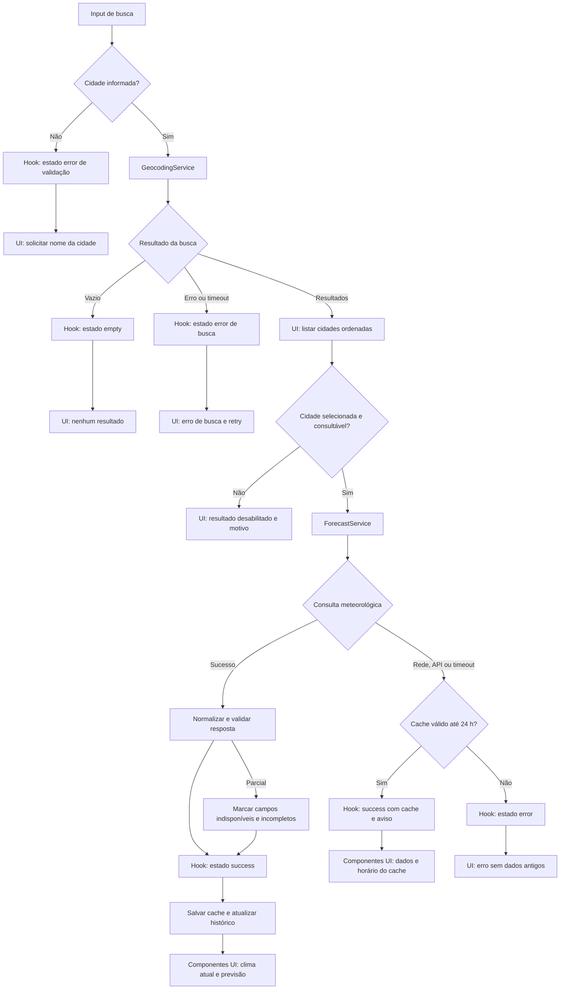

# Plano Técnico: Weather App

Este plano deriva da [especificação do produto](../specs/weather-app-spec.md). Os identificadores RF, CA e RNF indicam rastreabilidade; a implementação deve preservar os comportamentos definidos na spec.

## Architecture

Aplicação web client-side, sem backend próprio, dividida por responsabilidade e com dependências em uma direção:

```text
components -> hooks -> services -> APIs externas / armazenamento do navegador
     |          |         |
     +----------+---------+----> lib (funções puras)
              types (contratos compartilhados)
```

- `components/` cuida da apresentação e acessibilidade: recebe dados/estados por props e comunica ações por callbacks; não chama APIs nem acessa armazenamento.
- `hooks/` orquestra estado React e fluxos de busca, seleção, consulta, retry e unidade; coordena serviços, cancelamento/obsolescência de respostas e transições de estado, sem implementar parsing da API.
- `services/` contém os adaptadores com efeitos colaterais: `GeocodingService` consulta e mapeia geocoding; `WeatherService` consulta e valida o forecast; `StorageService` lê/grava unidade, favoritos, histórico e cache local. Serviços retornam modelos internos e erros tipados, sem expor payloads brutos à UI.
- `lib/` reúne funções determinísticas sem efeitos colaterais: ordenação de cidades, validação/mapeamento de campos, tabela WMO pt-BR, conversão/formatação de temperatura e operações de data local. Entradas como instante atual e fuso são parâmetros explícitos.
- `types/` define contratos compartilhados entre as camadas, sem lógica de runtime.
- Direção permitida: componentes dependem de hooks e tipos; hooks dependem de serviços, lib e tipos; serviços dependem de lib e tipos; `lib/` não depende de React, serviços, APIs ou armazenamento.
- Essa separação permite testar `lib/` com entradas/saídas determinísticas sem mocks; serviços com `fetch` e armazenamento simulados; hooks com serviços substituídos; e componentes com props/eventos focados na interface. E2E valida a integração pelo fluxo do usuário, sem tornar os testes unitários dependentes da rede.
- A apresentação representa estados explícitos de carregamento, vazio, erro, incompleto, online e cache/offline conforme RF-05.
- Não solicitar geolocalização, criar conta, enviar preferências ao servidor ou sincronizar dados pessoais (RF-06, RF-08, RNF-08).

## Tech Stack

- TypeScript strict, React 19 e Vite: stack já configurada no projeto, adequada à aplicação responsiva sem backend.
- Tailwind CSS: estilização conforme configuração existente, mantendo o tema dark glassmorphism definido para o projeto.
- Open-Meteo Geocoding e Forecast: fonte especificada, sem API key para o escopo do produto.
- `localStorage` e APIs nativas do navegador: persistência simples no mesmo dispositivo e navegador; encapsular acesso para tratar indisponibilidade/corrupção.
- Vitest, Testing Library e Playwright: testes de lógica, componentes e fluxos reais no navegador.
- pnpm e Biome: ferramentas já configuradas para dependências, lint e formatação.

Não adicionar estado global ou biblioteca de data/time inicialmente. Usar estado React na raiz do fluxo e APIs nativas de internacionalização; adicionar dependências somente se uma necessidade concreta não puder ser atendida pela stack atual.

## Project Structure

Estrutura proposta, compatível com as convenções do projeto:

```text
src/
  components/                 # UI sem acesso direto a dados externos
    CitySearch.tsx            # Formulário e resultados de geocoding
    CurrentWeather.tsx        # Condições atuais e estado de incompletude
    ForecastView.tsx          # Cinco dias e detalhe por hora
    SavedCities.tsx           # Favoritos e histórico
  hooks/                      # Orquestração do estado e dos fluxos
    useCitySearch.ts          # Busca, estados vazio/erro e seleção
    useWeather.ts             # Consulta, cache/fallback e dia selecionado
    usePreferences.ts         # Unidade, favoritos e histórico
  services/                   # Limites com efeitos colaterais
    geocodingService.ts       # HTTP de geocoding e adaptação de resultados
    weatherService.ts         # HTTP de forecast e adaptação para WeatherData
    storageService.ts         # Persistência local resiliente
  lib/                        # Funções puras e reutilizáveis
    citySorting.ts            # Correspondência e ordenação pt-BR
    weatherMapping.ts         # Códigos WMO e interpretação de campos
    temperature.ts            # Conversão e arredondamento
    localDate.ts              # Datas/horas no fuso IANA
  types/                      # Contratos compartilhados
    weather.ts                # City, CurrentWeather, ForecastDay, WeatherData, Unit
tests/
  unit/                       # Testes de lib, serviços, hooks e componentes
  e2e/                        # Fluxos do produto no navegador
```

Os nomes acima são módulos sugeridos, não obrigação de criar todos de uma vez. Manter um componente por arquivo. Evitar pastas por cada conceito pequeno; dividir quando houver responsabilidade ou teste que justifique.

## Data Model

Contratos conceituais em TypeScript; não são código final. Dados meteorológicos são armazenados em Celsius e convertidos somente na apresentação (RF-04).

```ts
type Unit = 'celsius' | 'fahrenheit';

interface GeocodingCandidate {
  sourceIndex: number; // Posição original na resposta, usada para desempate estável
  name: string; // Nome da cidade retornado pelo geocoding
  adminRegion: string | null; // Região administrativa (admin1); null se ausente
  country: string | null; // País; null se ausente
  latitude: number | null; // Coordenada original; null se ausente ou inválida
  longitude: number | null; // Coordenada original; null se ausente ou inválida
  timeZone: string | null; // Fuso IANA original; null se ausente ou inválido
}

interface City {
  id: string; // Identificador estável derivado de coordenadas e fuso IANA
  name: string; // Nome da cidade retornado pelo geocoding
  adminRegion: string | null; // Região administrativa (admin1); null se ausente
  country: string | null; // País; null se ausente
  latitude: number; // Latitude usada na consulta meteorológica
  longitude: number; // Longitude usada na consulta meteorológica
  timeZone: string; // Fuso IANA retornado pelo geocoding, obrigatório para seleção
}

interface CurrentWeather {
  observedAtEpochSeconds: number; // Instante da observação recebido da API
  temperatureCelsius: number | null; // Open-Meteo temperature_2m, na origem em °C
  apparentTemperatureCelsius: number | null; // Open-Meteo apparent_temperature, em °C
  weatherCode: number | null; // Código WMO retornado pelo provedor
  condition: string | null; // Condição localizada em pt-BR; null para código inválido
  windSpeedKmh: number | null; // Open-Meteo wind_speed_10m, em km/h
  relativeHumidityPercent: number | null; // Open-Meteo relative_humidity_2m, de 0 a 100
  isIncomplete: boolean; // Indica se algum campo obrigatório ficou indisponível
}

interface HourlyForecast {
  timestampEpochSeconds: number; // Instante da amostra; distingue horas repetidas no horário de verão
  localDateTime: string; // Horário local 24 h derivado do instante e do fuso IANA
  temperatureCelsius: number | null; // Open-Meteo temperature_2m, em °C
  weatherCode: number | null; // Código WMO da hora
  condition: string | null; // Condição localizada em pt-BR; null para código inválido
  precipitationMm: number | null; // Open-Meteo precipitation, em milímetros
  isIncomplete: boolean; // Indica se algum campo da hora ficou indisponível
}

interface ForecastDay {
  localDate: string; // Data YYYY-MM-DD derivada no fuso IANA da cidade
  temperatureMaxCelsius: number | null; // Open-Meteo temperature_2m_max, em °C
  temperatureMinCelsius: number | null; // Open-Meteo temperature_2m_min, em °C
  weatherCode: number | null; // Código WMO diário retornado pelo provedor
  condition: string | null; // Condição localizada em pt-BR; null para código inválido
  hours: HourlyForecast[]; // Horários pertencentes a esta data local
  isIncomplete: boolean; // Indica se algum campo diário ou horário ficou indisponível
}

interface WeatherData {
  city: City; // Localidade consultada
  current: CurrentWeather; // Condições atuais retornadas pelo provedor
  forecast: ForecastDay[]; // Hoje local e os quatro dias seguintes
  fetchedAt: string; // Instante UTC da última atualização meteorológica bem-sucedida
}

interface HistoryEntry {
  city: City; // Localidade selecionada e consultada com dados válidos
  lastConsultedAt: string; // Instante UTC da consulta bem-sucedida mais recente
}

interface AppPreferences {
  unit: Unit; // Unidade de temperatura escolhida; padrão Celsius
  favorites: City[]; // Localidades favoritas armazenadas neste dispositivo
  history: HistoryEntry[]; // Histórico mais recente primeiro, sem duplicatas
  weatherCache: Record<string, WeatherData>; // Snapshot por City.id, válido por até 24 h
}
```

O geocoding produz `GeocodingCandidate`, que permite apresentar metadados incompletos. Um candidato só pode ser convertido em `City` quando latitude/longitude forem finitas e o fuso IANA for válido; favoritos, histórico e forecast armazenam apenas `City` selecionável (RF-01/RF-06). Candidatos sem região/país usam `null` e permanecem selecionáveis. A chave `City.id` é determinística a partir de coordenadas e fuso para deduplicar histórico/cache. Cache válido quando `now - fetchedAt <= 24h`; relógio futuro ou payload ilegível não deve ser tratado como dado atual.

## Data Flow

1. Na inicialização, ler preferências, favoritos, histórico e cache. Sem histórico, aguardar busca manual (RF-08). Com histórico e sem conexão, selecionar a entrada mais recente e exibir somente cache válido; se ausente/expirado, mostrar estado offline sem consulta de rede (RF-07).
2. Com conexão e histórico existente, selecionar a localidade mais recente e buscar atualização meteorológica. Exibir feedback após 200 ms e encerrar a solicitação em 8 segundos (RF-05, RF-08).
3. Na busca, validar cidade obrigatória, chamar geocoding, normalizar campos e ordenar: correspondências exatas sem acento/caixa primeiro; região/país para exatas; cidade/região/país para demais; pt-BR, ausentes ao final e ordem original para empate (RF-01). Pontuação permanece significativa.
4. Busca vazia termina em estado sem resultados. Erro/timeout de geocoding termina em erro de busca e nunca usa cache meteorológico (RF-05).
5. Ao selecionar resultado, solicitar clima atual e previsão. A seleção explícita define a localidade, inclusive para cidades homônimas. Uma resposta interpretável é validada campo a campo; cada campo inválido fica indisponível e os demais permanecem utilizáveis (RF-02, RF-03).
6. Calcular cinco dias a partir da data local da cidade; derivar datas e rótulos horários dos timestamps de origem no fuso IANA, preservando instantes distintos durante transições de horário de verão. Iniciar detalhe diário em hoje local (RF-03).
7. Em sucesso, apresentar dados, gravar snapshot e horário, e inserir/mover a localidade para o início do histórico. Registrar consulta quando dados válidos são mostrados online ou de cache; buscas sem seleção e falhas sem cache não entram no histórico (RF-06, RF-08).
8. Em falha meteorológica, exibir cache válido com data/hora e aviso; sem cache válido, exibir erro sem rotular dados antigos como atuais. Alternar unidade apenas reformata temperaturas visíveis e persiste a preferência (RF-04, RF-05).



## External APIs

### Geocoding

- URL: `https://geocoding-api.open-meteo.com/v1/search?name=Lisbon&count=100&language=pt&format=json`.
- Parâmetros relevantes: `name` é obrigatório e recebe o nome da cidade; `count=100` pede o limite máximo de candidatos; `language=pt` localiza metadados quando disponíveis; `format=json` solicita JSON. Não presumir parâmetros de filtro por país/região: comparar localmente os metadados `country` e `admin1` dos candidatos retornados com os refinadores informados. A API não recebe `current`, `daily` nem `timezone` para geocoding.
- Exemplo resumido de resposta:

```json
{
  "results": [
    {
      "id": 2267057,
      "name": "Lisbon",
      "latitude": 38.7167,
      "longitude": -9.1333,
      "country_code": "PT",
      "country": "Portugal",
      "admin1": "Lisboa",
      "timezone": "Europe/Lisbon"
    }
  ],
  "generationtime_ms": 0.2
}
```

- Mapeamento: converter cada item da resposta para `GeocodingCandidate`: `name`, `admin1`, `country`, `latitude`, `longitude` e `timezone`; manter `sourceIndex` para empate estável. Filtrar por país/região localmente quando fornecidos, comparando metadados normalizados; candidato sem o metadado solicitado não satisfaz o filtro. Depois ordenar conforme RF-01. Exibir candidatos sem coordenadas ou fuso como não selecionáveis. Ao selecionar, validar os dados e criar `City`, gerando `City.id` a partir de coordenadas e fuso IANA. O limite de 100 pode truncar candidatos; aceitar esse limite do provedor no MVP e não adicionar paginação/múltiplas consultas sem evidência de necessidade.
- Timeout de 8 segundos; resultado vazio e falha técnica são estados distintos. Falha de geocoding nunca recorre a cache meteorológico (RF-05).

### Forecast

- URL-base: `https://api.open-meteo.com/v1/forecast`.
- Exemplo de URL com parâmetros (coordenadas e fuso vêm da cidade selecionada):

```text
https://api.open-meteo.com/v1/forecast?latitude=38.7167&longitude=-9.1333&current=temperature_2m,relative_humidity_2m,apparent_temperature,weather_code,wind_speed_10m&daily=weather_code,temperature_2m_max,temperature_2m_min&hourly=temperature_2m,weather_code,precipitation&temperature_unit=celsius&wind_speed_unit=kmh&precipitation_unit=mm&timezone=Europe%2FLisbon&forecast_days=5&timeformat=unixtime
```

- Parâmetros relevantes: `latitude`/`longitude` identificam a cidade; `current` seleciona campos atuais; `daily` seleciona máximas, mínimas e código WMO; `hourly` seleciona temperatura, código WMO e precipitação horária; `timezone` recebe o fuso IANA da cidade; `forecast_days=5` cobre hoje local e os quatro dias seguintes; `timeformat=unixtime` preserva instantes sem ambiguidade em horas repetidas. Usar `temperature_unit=celsius`, `wind_speed_unit=kmh` e `precipitation_unit=mm` para manter o modelo normalizado. Não usar `timezone=auto`, pois o plano usa o fuso validado no resultado de geocoding.
- Exemplo resumido de resposta (arrays diários/horários foram abreviados):

```json
{
  "latitude": 38.72,
  "longitude": -9.13,
  "timezone": "Europe/Lisbon",
  "current_units": {
    "temperature_2m": "°C",
    "relative_humidity_2m": "%",
    "apparent_temperature": "°C",
    "weather_code": "wmo code",
    "wind_speed_10m": "km/h"
  },
  "current": {
    "time": 1794405600,
    "temperature_2m": 18.4,
    "relative_humidity_2m": 62,
    "apparent_temperature": 18.1,
    "weather_code": 2,
    "wind_speed_10m": 12.5
  },
  "hourly": {
    "time": [1794405600, 1794409200],
    "temperature_2m": [18.4, 17.9],
    "weather_code": [2, 3],
    "precipitation": [0.0, 0.2]
  },
  "daily": {
    "time": [1794355200, 1794441600, 1794528000, 1794614400, 1794700800],
    "temperature_2m_max": [19.2, 18.8, 17.5, 16.9, 18.0],
    "temperature_2m_min": [13.1, 12.8, 11.9, 12.0, 12.6],
    "weather_code": [2, 3, 61, 3, 2]
  }
}
```

- Mapeamento para o modelo: validar que `timezone` da resposta corresponde ao solicitado. `current.time` -> `CurrentWeather.observedAtEpochSeconds`; `temperature_2m` -> `temperatureCelsius`; `apparent_temperature` -> `apparentTemperatureCelsius`; `relative_humidity_2m` -> `relativeHumidityPercent`; `wind_speed_10m` -> `windSpeedKmh`; `weather_code` -> código e rótulo pt-BR via tabela WMO. Converter cada timestamp de `daily.time` no fuso da cidade para `ForecastDay.localDate`; combinar por índice máximas/mínimas e código. Para cada timestamp de `hourly.time`, criar `HourlyForecast.timestampEpochSeconds`, derivar `localDateTime` no fuso IANA e agrupar pelo dia local correspondente.
- Arrays devem ser alinhados por índice; formatar datas na UI como DD/MM/AAAA e horas em 24 h com `Intl.DateTimeFormat('pt-BR', { timeZone, ... })`. Campo inválido ou ausente vira `null` e marca o dia/hora como incompleto; timestamp fora do dia local ou estrutura ilegível segue a validação e fallback de erro descritos acima. `WeatherData.fetchedAt` é o instante UTC local da consulta bem-sucedida, não `current.time`.
- Timeout meteorológico de 8 segundos. Uma única solicitação com dados atuais, diários e horários evita chamadas separadas e permite cache consistente; gravar cache apenas após resposta estruturalmente interpretável.

## State Management

O estado de execução vive em React, sem biblioteca global. O componente raiz compõe `useCitySearch`, `useWeather` e `usePreferences`; cada hook é dono do estado do seu fluxo. `CitySearch` mantém localmente apenas o texto ainda não enviado. Cidade selecionada, detalhe de dia e conectividade pertencem ao fluxo principal. Unidade, favoritos, histórico e cache são carregados e persistidos por `StorageService` em `localStorage` (RF-06/RF-07).

Busca e consulta meteorológica mantêm estados discriminados separados, usando os estados explícitos `idle`, `loading`, `success`, `empty` e `error`. Um contrato conceitual comum:

```ts
type AppError = {
  kind: 'network' | 'api' | 'timeout' | 'invalid-response';
  message: string;
};

type AsyncState<T> =
  | { status: 'idle' }
  | { status: 'loading'; startedAt: number }
  | { status: 'success'; data: T; source?: 'network' | 'cache'; warning?: AppError }
  | { status: 'empty'; reason: 'no-results' | 'offline-no-recent-cache' }
  | { status: 'error'; error: AppError; retryable: boolean };
```

`empty/no-results` representa geocoding bem-sucedido sem cidades; `empty/offline-no-recent-cache` representa ausência de dados utilizáveis offline. Erro de atualização com cache válido é `success` com `source: 'cache'` e aviso, para os dados permanecerem visíveis e identificados. `WeatherData` marca campos parciais por `isIncomplete`; isso não muda o estado global de `success`.

Temperaturas ficam armazenadas e cacheadas em Celsius. Durante a renderização, a camada de apresentação deriva o valor exibido por uma função pura: Celsius mantém o valor original; Fahrenheit calcula $F = C \times 9/5 + 32$. Arredondar apenas o resultado final para uma casa decimal, com empate para longe de zero, e formatar com vírgula decimal pt-BR. Datas são exibidas como DD/MM/AAAA e horas no ciclo de 24 h com `Intl.DateTimeFormat` e o fuso IANA da cidade. Unidade, vento (km/h) e precipitação (mm) não alteram a consulta nem os dados meteorológicos; alternar unidade apenas atualiza preferência e renderização, sem novo request ou recálculo do cache (RF-04/RF-03/RNF-07).

Ações concorrentes devem ignorar respostas antigas após busca/seleção mais recente. `navigator.onLine` e eventos `online`/`offline` orientam o fluxo, mas o resultado real da requisição é autoridade sobre conectividade. Falha de `localStorage` não bloqueia consulta online, mas deve ser informada se impedir persistência ou uso offline (RF-06/RF-07).

## Error Handling

- **Rede/offline:** não iniciar requests meteorológicos quando a aplicação sabe que está offline. Ao selecionar uma cidade offline, exibir cache com até 24 horas, origem e horário; sem cache válido, usar `empty/offline-no-recent-cache`. Se o navegador reportar online mas `fetch` falhar, tratar como falha de rede e aplicar o mesmo fallback meteorológico. Geocoding offline resulta em erro de busca, sem usar cache meteorológico (RF-05/RF-07).
- **API/HTTP:** resposta não-2xx, erro de protocolo ou falha ao interpretar JSON é erro técnico, distinto de resposta válida com lista de geocoding vazia (`empty/no-results`). Geocoding mostra erro de busca; não consulta cache meteorológico. Para forecast, usar cache válido com aviso ou `error` sem dados, conforme disponibilidade (RF-05).
- **Timeout:** envolver cada request em `AbortController` com limite de 8 segundos. Timeout de geocoding mostra erro de busca; timeout meteorológico mostra mensagem específica e usa cache válido se existir. Cancelamento por nova busca/seleção não deve ser apresentado como erro. Indicar loading quando a ação passar de 200 ms (RF-05).
- **Resposta parcial:** validar campos individualmente e manter válidos; campo ausente, não finito ou fora do domínio vira `null`/“Indisponível” e marca o campo/dia como incompleto. Regras: umidade 0–100%, vento/precipitação não negativos, máxima >= mínima, timestamp no dia local pedido e código WMO reconhecido para condição. Código desconhecido invalida só a condição (RF-02/RF-03).
- **Resposta estruturalmente inválida:** JSON ilegível, arrays essenciais que não possam ser associados por índice ou timestamps impossíveis de interpretar invalidam o snapshot inteiro; aplicar erro e fallback de cache meteorológico. Não salvar payload inválido no cache.
- **Cache:** válido por até 24 horas, inclusive no limite exato; exibir sempre origem e `fetchedAt`. Em falha/timeout meteorológico, cache válido resulta em `success` com `source: 'cache'` e aviso. Sem cache válido, `error` sem apresentar valores antigos como atuais (RF-05/RF-07).
- **Armazenamento:** capturar falhas de leitura/escrita, continuar consulta online quando possível e comunicar que preferências/dados não puderam ser mantidos. Não indicar sucesso de persistência ou disponibilidade offline quando a gravação falhou.
- Mensagens e retry devem ser acessíveis por teclado e leitores de tela; não fazer retries automáticos ilimitados (RNF-04).

## Testing Strategy

- **Vitest — funções puras (`lib/`):** conversão Celsius/Fahrenheit a partir do valor Celsius original (0 °C, 100 °C, -40 °C e empate 20,25 °C -> 68,5 °F), arredondamento longe de zero e formatação pt-BR; provar que vento e precipitação não são convertidos. Cobrir ordenação/refinamento de geocoding por país/região (acentos, caixa, metadados ausentes e empate estável), seleção apenas de candidatos com coordenadas/fuso válidos, códigos WMO, validação campo a campo, cinco datas/horários locais, transições de horário de verão, formatação DD/MM/AAAA e 24 h, chave de cidade, deduplicação e validade de cache no limite de 24 horas.
- **Vitest — services:** mockar `fetch` para verificar URL/parâmetros (inclusive `count=100`) e mapeamento Open-Meteo; resposta válida, geocoding vazio, falha de rede, HTTP não-2xx, JSON inválido, timeout de 8 segundos, payload parcial e fallback com/sem cache. Assegurar que filtros locais por país/região são aplicados, que falha de geocoding nunca consulta cache meteorológico e que dados inválidos não são persistidos. Mockar o armazenamento para leituras/escritas válidas, corrompidas e indisponíveis.
- **Vitest + Testing Library — componentes/hooks:** verificar os estados `idle`, `loading` (após 200 ms), `success`, `empty` e `error`; resultado de cache com aviso, sucesso incompleto, seleção de cidade/dia, retry e preferência persistida. Exercitar interação por teclado, roles/labels e ausência de chamada de rede ao alternar unidade.
- **Playwright — fluxos E2E:** busca com refinadores de país/região e seleção explícita (incluindo candidato desabilitado), clima atual e previsão de cinco dias/detalhe horário; estado sem resultados e erro de busca; datas DD/MM/AAAA e horários 24 h; favorito/histórico e reconsulta; abertura online/offline; falha de atualização com e sem cache válido; troca de unidade sem request extra. Interceptar respostas para cenários determinísticos, sem depender da disponibilidade do provedor.
- **Playwright — viewport mobile:** exercitar os fluxos principais em 320 px e 375 px e em viewport desktop de 1440 px; verificar ausência de rolagem horizontal, conteúdo e controles utilizáveis e acesso por teclado. Esses viewports complementam, mas não substituem, testes nos navegadores/dispositivos da matriz RNF-06.
- Cobrir critérios CA-01 a CA-08 com uma combinação de testes unitários, de componente e E2E; medir p95 de 3 segundos em rede móvel 4G separadamente dos testes determinísticos (RNF-03). Usar a suíte determinística no CI; reservar compatibilidade completa, usabilidade e disponibilidade para validações próprias de release (RNF-02, RNF-05, RNF-06).

## Risks & Trade-offs

| Decisão / alternativa considerada | Trade-off e resposta técnica |
| --- | --- |
| Refinamento de geocoding local com até 100 candidatos; alternativa: múltiplas consultas/paginação | Comparar `country`/`admin1` retornados é simples e não depende de parâmetros de filtro incertos. O limite do provedor pode truncar resultados; aceitar essa limitação no MVP e reavaliar se buscas reais mostrarem falsos vazios (RF-01). |
| Timestamps epoch com fuso IANA; alternativa: armazenar apenas horário local | Um instante epoch distingue horas repetidas e permite derivar a data/hora local com `Intl.DateTimeFormat`, sem biblioteca extra. Manter horário local só como valor de apresentação e testar transições (RF-03/RNF-07). |
| Aplicação client-side sem backend próprio; alternativa: proxy/backend | Mantém dados do usuário no dispositivo e reduz operação/infraestrutura. Um backend poderia centralizar cache, observabilidade e controle de chamadas, mas adicionaria custo e superfície de dados, contrariando o escopo sem servidor; reavaliar apenas se escala/limites do provedor exigirem (RF-06, RNF-08). |
| React state/hooks locais; alternativa: biblioteca global | Hooks e estado próximo ao fluxo bastam para busca, consulta e preferências sem dependência adicional. Estado global simplificaria compartilhamento em uma aplicação maior, mas adicionaria complexidade sem necessidade atual; manter contratos dos hooks para evolução. |
| `localStorage`; alternativa: IndexedDB ou servidor | Simples para preferências, favoritos, histórico e snapshots pequenos; é síncrono, pode ser apagado ou falhar. IndexedDB escala melhor para maior volume, mas aumenta complexidade; servidor permitiria sincronização, fora do escopo de privacidade. Tratar falhas e não prometer cache não persistido (RF-06/RF-07/RNF-08). |
| Um request agregado do Forecast API; alternativa: requests separados | Reduz latência e facilita consistência do snapshot/cache. Uma falha HTTP afeta a resposta toda; a validação por campo preserva dados válidos dentro de resposta parcial. Separar chamadas só se uma necessidade medida exigir (RNF-03). |
| Celsius como unidade canônica; alternativa: refazer request para unidade escolhida | Permite alternância instantânea e mantém cache independente da preferência. Exige conversão/rounding rigorosos; validar por funções puras e sempre derivar do valor Celsius, sem converter valores já arredondados (RF-04). |
| Preservar campos válidos em resposta parcial; alternativa: descartar resposta inteira | Mantém informação útil, mas exige validação e indicadores de incompletude por campo. Descartar tudo é mais simples, porém esconde medições válidas; rejeitar o snapshot somente quando a estrutura não puder ser interpretada (RF-02/RF-03). |
| `localStorage`/`fetch` mockados nos testes; alternativa: API real em toda a suíte | Testes mockados são rápidos e reproduzíveis e cobrem falhas difíceis de obter ao vivo. Podem não detectar mudanças reais do provedor; manter validação de contrato/monitoramento separado, sem tornar o CI dependente de rede externa. |
| Cache local por até 24 horas; alternativa: não manter cache ou aceitar idade maior | Cache melhora disponibilidade offline sem mostrar informação excessivamente antiga; requer sinalização de origem/idade e fallback cuidadoso. Janela maior aumenta chance de decisões com dados obsoletos; não ampliar sem rever a spec (RF-05/RF-07). |
| Viewports Playwright como complemento; alternativa: apenas testes desktop ou matriz integral em cada execução | Testar 320/375 px identifica regressões móveis com custo moderado; viewport não representa todos os dispositivos reais. Matriz completa em cada PR pode ser lenta; executar compatibilidade ampliada como validação de release (RNF-01/RNF-06). |
| Dependência da Open-Meteo | Latência, disponibilidade e mudanças de contrato são externas; timeout, validação e cache mitigam falhas. Monitorar disponibilidade da API separadamente da disponibilidade da interface (RNF-05). |

Fora do escopo de implementação: mapas, alertas, contas/sincronização, geolocalização automática, idiomas adicionais e previsões além dos cinco dias (spec, Out of Scope).